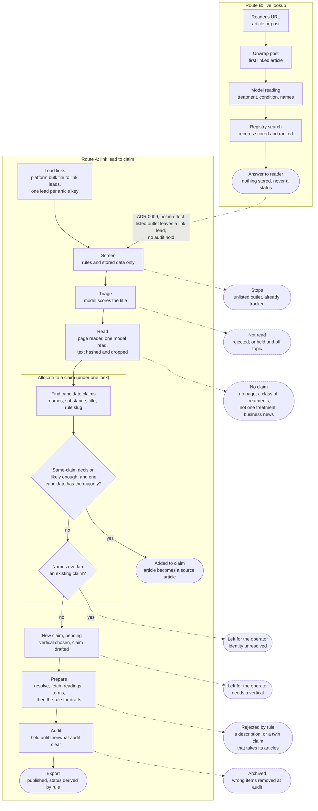

# From a URL to a claim

How an article or post address becomes, or joins, a claim. Two routes take an address.
Route A (the backfill's link leads) is the only one that makes or changes a claim today.
Route B (a reader's live lookup) answers the reader and stores nothing; its hand-off into
Route A is decided in `adr/0009` and is not in effect until
`openspec/changes/cloudflare-source-of-truth` turns it on.

Behavior is defined in `openspec/` (link-leads, lead-screening, lead-triage, lead-reading,
claim-extraction, live-lookup). This page is a map of the code, not a specification.

Solid arrows are the path to a published claim. Dashed arrows are where a lead leaves it.

## Where each step lives

| Step | Code | Notes |
| --- | --- | --- |
| Load links | `pipeline/src/thenwhat/backfill/link_load.py`, `link_readers.py`, `address.py` | Keeps address, community, time, score and title. Nothing about who posted. |
| Screen | `backfill/link_screen.py` | No request, no model. Links to claims and trials are candidates only. |
| Triage | `backfill/link_triage.py` | Stores a score. Passed, held or rejected comes from two operator thresholds each time it is asked. |
| Read | `backfill/link_read.py` (`LinkRead.run`, `_read`) | Refused until triage has been measured. Reads passed leads, and held leads whose title names an operator topic. |
| Allocate | `backfill/link_read.py` (`_claim_it_reports`, `_join`), `extract/service.py` | With no candidate the decision is skipped. An unresolved read is never retried: the operator attaches or dismisses it. |
| Prepare | `pipeline/src/thenwhat/prepare.py` | `thenwhat prepare --pending`. Approved when the intervention is a name and no other claim has its substance, form and condition. |
| Audit, export | `cli/audit.py`, `export/build.py` | `adr/0007`: a backfill claim waits for `thenwhat audit clear`. |
| Live lookup | `site/worker/lookup.mjs`, `pipeline/src/thenwhat/lookup/service.py`, `extract/post.py` | Two implementations kept in step. Posts are unwrapped on this route only. |
